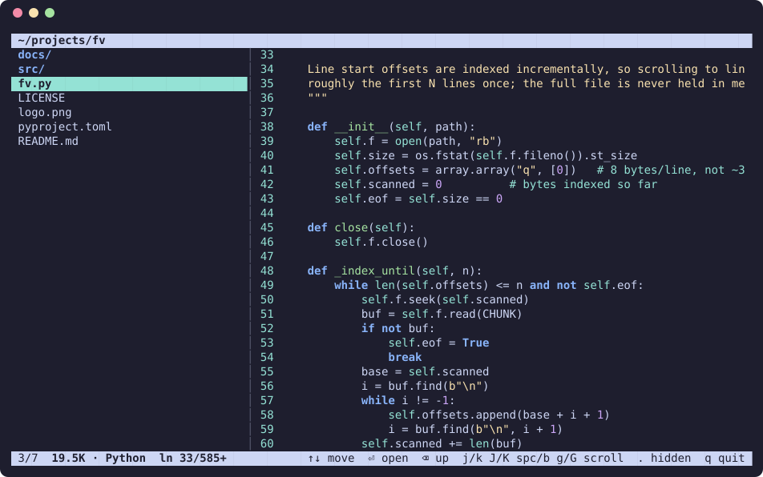

# fv

A read-only terminal file explorer with a live preview pane. Move the selection
and the right pane immediately shows the highlighted file's contents.



- Pure stdlib (`curses`); [Pygments](https://pygments.org) optional for syntax highlighting
- Large files are read lazily — only the visible lines are loaded
- Friendly messages for binary, empty, unreadable, and special files
- Mouse text selection inside the preview only: drag to select, auto-scrolls past the panel edges,
  copies the exact file text (original indentation and line endings) to the clipboard
- Adapts to terminal resizing; never modifies anything

## Install

```bash
uv tool install 'git+https://github.com/andresmillang/fileview[highlight]'
# or just run it:
python3 fv.py [DIRECTORY]
```

## Keys

| Key | Action |
|---|---|
| ↑ ↓ PgUp PgDn Home End | move selection (preview updates live) |
| Enter / → | open directory |
| Backspace / ← | parent directory |
| `j`/`k` `J`/`K` space/`b` `g`/`G` | scroll preview: line / 10 lines / page / top-bottom |
| `.` | toggle hidden files |
| Ctrl-L | redraw the screen |
| mouse drag (preview) | select text; hold past the top/bottom edge to auto-scroll; copies on release |
| `y` / Esc | copy the selection again / clear it |
| mouse wheel | scroll the panel under the pointer |
| click (file list) | select an entry |

Copying uses `wl-copy`, `xclip`, `xsel`, `pbcopy` or `clip.exe` when available, and always also sends
OSC 52 so it works over SSH and in tmux (needs a terminal that allows clipboard writes).
Your terminal's own native selection is still available with **Shift+drag**.
| `q` / `Q` | quit |
